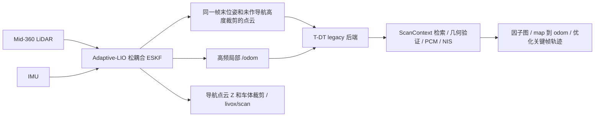
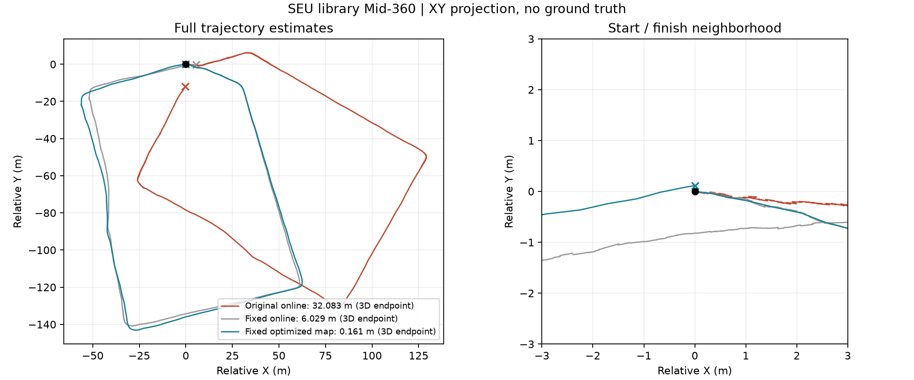
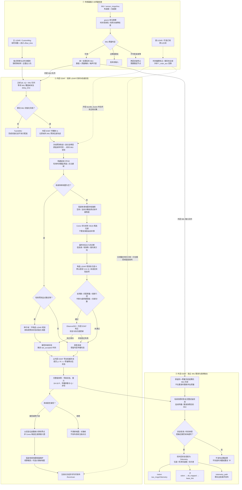

# ada-localization

面向 RoboMaster 哨兵的 **Adaptive-LIO 松耦合里程计 + 独立 T-DT 因子图后端**，当前验证环境为 Ubuntu 24.04 / ROS 2 Jazzy，包含 Mid-360 专用配置、ScanContext 裁剪前点云接口、后端修复补丁和数据验证记录。

本仓库延续 [ECUST-Origin-Sentry-Team/Adaptive-LIO](https://github.com/ECUST-Origin-Sentry-Team/Adaptive-LIO) 的工程改造，独立后端来自 [mozihe/z-localization](https://github.com/mozihe/z-localization)。**没有切换为上游 ZLIO 紧耦合前端。** 当前仓库名为 `ada-localization`，ROS 包名仍为 `adaptive_lio`。

## 当前实现



- 后端接口为 `/adaptive_lio/backend/odometry` 和 `/adaptive_lio/backend/cloud`，采用相同帧末时间戳；高频 `/odom` 独立输出。
- 原 ScanContext 回调和后端点云入口位于导航高度、车体裁剪之前，避免世界 Z 裁剪破坏描述子。此处点云仍经过前端采样和去畸变，并非原始全分辨率点云。
- Mid-360 前端使用几何自适应激光观测协方差；原 `mapping_m.yaml` 的默认配置保留。
- 后端补丁增加可选重访配准初值、起点历史邻域，并修复历史 PCM 支持数为 0 时被归一化强制改成 1 的问题。
- Mid-360 专用后端采用 Huber 核、至少三个当前一致候选和完整六维 NIS；禁用不适用的固定世界 Z 残差与历史 PCM 支持要求。其他配置不自动启用这些专用策略。

后端源码已直接纳入 [`src/tdt_backend`](src/tdt_backend/UPSTREAM.md)，包含已应用补丁的 backend、localization_interfaces、默认配置及 GPL-2.0 许可。一次克隆即可获取前后端源码；系统依赖仍需手动安装。

## 已验证结果及口径

SEU library Mid-360 原包约 429.83 秒，保留消息与原始时间戳，以 1 倍速回放。最终完整运行观察器收到 85,965 条 IMU，无停链，相关进程退出码均为 0。

| 统计对象 | 3D 首尾距离 |
|---|---:|
| 原配置在线后端消息 | 32.083 m |
| 最终配置在线前端消息 | 6.027 m |
| 最终配置在线后端消息 | 6.029 m |
| **最终保存的优化关键帧轨迹** | **0.161 m** |
| 原始首尾点云独立配准估计 | 约 0.16～0.17 m |

最终接受了关键帧 `762 → 5` 的跨整圈约束，6 个候选形成一致团，NIS 概率 `0.0178481` 通过 `0.001` 门限。最后的闭环优化发生在最后一条 IMU 之后，因此最后在线消息保留修正前值；历史在线消息不会被回溯重写。**0.161 m 是优化轨迹闭合距离，不是在线末消息偏差，也不是真值 ATE。** 数据没有外部真值，不能由单包闭合推导全场景精度或稳定性结论。

2026-10-28 纳入完整后端后，统一工作空间的 4 个 ROS 包构建通过，前端 5 组 CTest 和后端 6 组代表性 CTest 通过，联合入口启动与正常退出通过。后端源码与此前本地跑包版本逐文件一致；本次源码整理没有重新完整回放，也没有验收空白系统的全流程依赖安装。原始 bag、本机依赖、构建产物和 Docker 镜像不随本次提交分发。

- [完整修复报告、失败对照和限制](docs/validation/mid360-fix-report.md)
- [最终指标 JSON](docs/validation/mid360-fixed-results.json) · [优化关键帧](docs/validation/mid360-fixed-keyframes.txt) · [关键日志](docs/validation/mid360-fixed-evidence.log)
- [原始首尾点云独立检查](docs/validation/seu-endpoint-check.md)
- [Avia quick-shack 验证与输入时间故障](docs/validation/quick-shack-report.md)



## 安装、构建和联合运行（人工配置）

目标平台：**Ubuntu 24.04 / ROS 2 Jazzy / C++17**。本仓库现在包含完整的 Adaptive-LIO 前端、T-DT 后端和消息接口源码；不需要另行克隆 `z-localization`，也不要再次应用历史补丁。GTSAM、nanoflann 等依赖由工程师安装到仓库外。以下命令使用 Bash。

### 1. 安装 ROS 2 和系统依赖

先按 [ROS 2 Jazzy Ubuntu deb 安装说明](https://docs.ros.org/en/jazzy/Installation/Ubuntu-Install-Debs.html) 配置 ROS 软件源并安装 `ros-jazzy-desktop`。完成后在新终端执行：

```bash
source /opt/ros/jazzy/setup.bash
sudo apt update
sudo apt install -y \
  build-essential cmake git python3-colcon-common-extensions python3-rosdep \
  python3-pytest python3-numpy python3-yaml \
  libeigen3-dev libpcl-dev libceres-dev libgoogle-glog-dev libgflags-dev \
  libyaml-cpp-dev libopencv-dev libsuitesparse-dev libboost-all-dev \
  libtbb-dev libmetis-dev libapr1-dev \
  ros-jazzy-ament-cmake-auto ros-jazzy-ament-cmake-gtest \
  ros-jazzy-ament-cmake-pytest ros-jazzy-launch-testing-ament-cmake \
  ros-jazzy-pcl-conversions ros-jazzy-tf2-eigen ros-jazzy-tf2-geometry-msgs \
  ros-jazzy-message-filters ros-jazzy-sensor-msgs-py \
  ros-jazzy-rosbag2 ros-jazzy-rosbag2-storage-mcap
```

### 2. 在仓库外准备 GTSAM 4.2 和 nanoflann 1.4.3

后端使用 GTSAM **4.2.x**，不要使用 4.3。nanoflann 固定 **1.4.3**；Ubuntu 24.04 的 1.5.x 与本后端的 `SearchParams` 接口不兼容。下面采用独立前缀源码安装，不需要 `sudo make install`，也不修改系统 GTSAM。

```bash
mkdir -p "$HOME/ada-deps/src"
git clone --branch 4.2 --depth 1 https://github.com/borglab/gtsam.git \
  "$HOME/ada-deps/src/gtsam-4.2"
cmake -S "$HOME/ada-deps/src/gtsam-4.2" -B "$HOME/ada-deps/build/gtsam-4.2" \
  -DCMAKE_BUILD_TYPE=Release \
  -DCMAKE_INSTALL_PREFIX="$HOME/ada-deps/install/gtsam-4.2" \
  -DCMAKE_INSTALL_LIBDIR=lib \
  -DGTSAM_USE_SYSTEM_EIGEN=ON \
  -DGTSAM_BUILD_TESTS=OFF -DGTSAM_BUILD_EXAMPLES_ALWAYS=OFF \
  -DGTSAM_BUILD_UNSTABLE=OFF -DGTSAM_BUILD_PYTHON=OFF \
  -DGTSAM_INSTALL_CPPUNITLITE=ON
cmake --build "$HOME/ada-deps/build/gtsam-4.2" --parallel 2
cmake --install "$HOME/ada-deps/build/gtsam-4.2"

git clone --branch v1.4.3 --depth 1 https://github.com/jlblancoc/nanoflann.git \
  "$HOME/ada-deps/src/nanoflann-1.4.3"
```

nanoflann 是头文件库，无需编译。GTSAM 编译内存不足时将 `--parallel 2` 改为 `--parallel 1`。Ubuntu 的部分 GTSAM 二进制包导出 `CppUnitLite` 却缺少对应静态库，会导致 CMake 报错；以上源码安装明确启用该库，不能用空文件或关闭后端测试绕过。

每个构建或运行终端都需要设置以下环境，也可以自行保存为仓库外的环境脚本：

```bash
source /opt/ros/jazzy/setup.bash
export GTSAM_DIR="$HOME/ada-deps/install/gtsam-4.2/lib/cmake/GTSAM"
export CMAKE_PREFIX_PATH="$HOME/ada-deps/install/gtsam-4.2:${CMAKE_PREFIX_PATH:-}"
export LD_LIBRARY_PATH="$HOME/ada-deps/install/gtsam-4.2/lib:${LD_LIBRARY_PATH:-}"
export NANOFLANN_INCLUDE_DIR="$HOME/ada-deps/src/nanoflann-1.4.3/include"
test -f "$GTSAM_DIR/GTSAMConfig.cmake"
test -f "$HOME/ada-deps/install/gtsam-4.2/lib/libCppUnitLite.a"
test -f "$NANOFLANN_INCLUDE_DIR/nanoflann.hpp"
```

### 3. 克隆仓库并检查依赖

```bash
git clone https://github.com/movoQAQ/ada-localization.git
cd ada-localization
# 仅首次初始化 rosdep 时执行；已经初始化过则跳过。
sudo rosdep init
rosdep update
rosdep install --from-paths src --ignore-src -y --rosdistro jazzy \
  --skip-keys 'gtsam libnanoflann-dev PCL'
```

跳过的三个键分别由步骤 2 的 GTSAM、nanoflann 和步骤 1 的 `libpcl-dev` 提供。`rosdep` 若有其他失败应先解决，不要忽略错误继续编译。`PCL` 是前端遗留清单键，不是另一个需要下载的库。

Livox 消息与驱动源码已在 `src/livox_ros_driver2` 中，现有仓库还沿用其随附的分架构 SDK 库；本次没有添加本机 SDK 或依赖产物。驱动 CMake 选择 `Livox-SDK2/lib/<架构>/liblivox_lidar_sdk_shared.so`，换架构需先确认该文件存在且与硬件匹配。回放 rosbag 不启动硬件驱动，但仍需要构建该包以生成消息类型。

### 4. 在同一个工作空间构建前后端

在只加载 ROS 和上述依赖、**没有加载其他同名工作空间**的终端，从仓库根目录执行：

```bash
MAKEFLAGS="-j2 -l2" CMAKE_BUILD_PARALLEL_LEVEL=2 colcon build --executor sequential \
  --packages-up-to adaptive_lio backend \
  --cmake-args -DBUILD_TESTING=ON \
  -DGTSAM_DIR="$GTSAM_DIR" \
  -DNANOFLANN_INCLUDE_DIR="$NANOFLANN_INCLUDE_DIR"
source install/setup.bash
ros2 pkg prefix adaptive_lio
ros2 pkg prefix backend
ros2 pkg prefix localization_interfaces
```

三个包应都解析到本仓库的 `install/`。`colcon` 会自动发现 `src/tdt_backend/src/` 下的两个后端包。不要再 source 旧的独立 `z-localization/install`。

验证：

```bash
ctest --test-dir build/adaptive_lio \
  -R '^adaptive_lio_(core|geometry|registration|pipeline|imu_quality)$' --output-on-failure
ctest --test-dir build/backend \
  -R '^backend_(descriptor|relocalization|localization|graph|measurement|lifecycle)_test$' \
  --output-on-failure
```

也可以执行 `bash tools/build_localization.sh -DGTSAM_DIR="$GTSAM_DIR"`，它封装同样的构建和代表性测试，不安装任何依赖。只构建后端时使用 `tools/build_tdt_backend.sh`。

### 5. 选择传感器配置并启动

| 配置 | 用途 |
|---|---|
| `mapping_m.yaml` | 默认单雷达：163 点云 + 163 IMU |
| `mapping_dual_publish.yaml` | 163 定位，160 点云仅加入导航输出；只使用 163 IMU，`enable_bundle_fusion=false` |
| `tdt_backend.yaml` | 已配好 Adaptive-LIO legacy 接口的独立后端配置，无云环境绝对路径 |
| `mapping_mid360.yaml` + `tdt_backend_mid360.yaml` | 历史 SEU Mid-360 实验组合，不能直接代替本机 163/160 配置 |

从仓库根目录启动默认单雷达联合定位：

```bash
source install/setup.bash
ros2 launch adaptive_lio tdt_backend.launch.py use_sim_time:=true
```

需要副雷达导航点云时，先停止上一次前后端，再启动：

```bash
ros2 launch adaptive_lio tdt_backend.launch.py use_sim_time:=true \
  frontend_config:="$(pwd)/src/Adaptive-LIO/config/mapping_dual_publish.yaml"
```

另开终端，加载 ROS、上述依赖环境及本仓库 `install/setup.bash` 后播放数据。将下例路径替换为实际 rosbag 目录：

```bash
ros2 bag info /absolute/path/to/rosbag
ros2 bag play /absolute/path/to/rosbag --clock --rate 1 --start-paused
# 等前后端初始化、订阅建立后，在播放器终端按空格开始。
```

实机运行使用 `use_sim_time:=false`，并另行启动已配置 IP/外参的 Livox 驱动。核对输入话题、CustomMsg 类型、逐点时间和外参；`gnorm=9.805` 仅适用于输入加速度单位为 g，输入为 m/s² 时不能再次乘重力加速度。

后端默认 mapping，关闭 UWB/先验地图，地图保存目录为启动工作目录下的 `./tdt-map`。如需修改，编辑 `tdt_backend.yaml` 中 `trajectory.save_directory`；这是普通路径，不会展开 `~`。前端发布 `odom → aft_mapped → base_link`，后端负责 `map → odom`；`tdt_sensor` 仍为当前后端参考系，换车要重新核对车体外参。

检查：

```bash
ros2 topic hz /odom
ros2 topic hz /adaptive_lio/backend/cloud
ros2 topic hz /livox/scan
ros2 run tf2_ros tf2_echo map odom
```

没有雷达输入、仍在静态初始化时，没有点云输出是正常的。需要静止起步；重播或故障后一起重启前后端。地图保存服务与地图包格式见 [后端说明](src/tdt_backend/src/backend/README.md)。

本次集成使用已有本地依赖完成验证；上面的独立前缀 GTSAM 源码安装流程依据 4.2 的构建选项整理，尚未在空白系统上端到端验收。历史回放工具中的 `/workspace/...` 路径属于原实验记录，不是新安装入口。


## 遗留问题与部署边界

| 问题 | 当前状态 / 影响 |
|---|---|
| IMU 时间故障 | 曾出现一次 `TimeFault(reason=8)` 并停链。独立观察器同段时间戳连续，前端实际接收序列未逐条记录，传输/调度原因尚未定位。没有关闭故障保护，不能宣布长期稳定性通过。 |
| 运动起步初始化 | 静态初始化逻辑未重写；移动起步可能导致误判或延迟初始化，不同运行的首条定位时间可能不同。尚未实现可靠的动态初始化。 |
| 世界 Z 与重力方向 | 初始世界 Z 不保证重力竖直。导航固定世界 Z 裁剪仍有语义限制；将描述子入口放到裁剪前并未解决重力坐标系本身。 |
| 尾部异步优化与在线输出 | bag 结束后完成的闭环可能尚未反映到最后一条在线定位消息。最终优化轨迹必须单独保存和评估，不能把两个口径混用。 |
| 真值与跨场景鲁棒性 | SEU library 无外部真值；未完成其他场景、重复走廊、升降坡道、动态遮挡和长期实车验证，不能报告未经验证的 ATE/RPE 或普适参数。 |
| 标定与统计门限 | 外参、驱动是否预变换、加速度单位需要逐设备核实。自适应协方差、世界 Z/历史 PCM 策略和 Huber 配置为当前实验配置，未完成跨设备统计标定。 |
| 重置和会话 | 当前使用 legacy 接口，未实现 ZLIO 原子会话/暖重置协议；故障或重新播放应一起重启前后端。 |
| 性能与实时性 | 最终回放在线输出最大时间戳间隔约 334 ms，未完成实时延迟预算验收。回放无崩溃不代表控制系统可直接使用。 |
| 可移植部署 | 当前联合配置和构建入口已移除云环境路径，前后端源码已合并交付；依赖手动安装，尚未在空白机器上完整验收。 |

## 来源、许可与工程说明

前端沿用原仓库历史及各组件许可声明；独立后端及其补丁遵循上游 `GPL-2.0-only`。第三方代码保留各自声明，不以新仓库名替换上游归属。原论文引用和前端内部设计见下文。

以下保留并更新原前端工程文档。其“默认配置”指单独运行的 `mapping_m.yaml`，不等同于上文显式选择的 Mid-360 联合定位配置。

---

## 前端工程说明


**面向 RoboMaster 哨兵机器人的 LiDAR–IMU 里程计 | ROS 2 Jazzy**

[](https://docs.ros.org/en/jazzy/)
[](https://ubuntu.com/)
[](https://isocpp.org/)
[](https://ieeexplore.ieee.org/document/10806842)

> 本仓库是基于 [原版 Adaptive-LIO](https://github.com/chengwei0427/Adaptive-LIO) 的工程化改造版本，主要用于 ECUST Origin Sentry 的 LiDAR–IMU 里程计开发与独立验证。**前端不是原论文的逐行复现；本仓库通过上文独立后端提供闭环定位集成，不包含完整导航或底盘控制系统。**
>
> 本仓库以 `main` 发布；原前端开发基线来自 `ljb`，下文默认参数指前端独立配置。

## 项目概览

该系统以 **LiDAR 几何观测约束漂移、IMU 高频传播提供及时运动状态** 为核心思路，采用内外双层 ESKF 数据流：

- **内层 ESKF（权威后验）**：IMU 传播 → 点云去畸变 → Ceres 帧末位姿配准 → 观测质量门控 → ESKF 校正；只有被接受的观测才能更新地图。
- **外层 ESKF（高频输出）**：安装内层提供的完整状态与协方差快照，重放快照之后的 IMU 历史，为 `/odom` 和 TF 提供连续状态。
- **点与时间语义统一**：使用传感器时间；逐点去畸变到当前 LiDAR 帧末 IMU 坐标；Ceres 只估计帧末位姿，不重复执行旧式插值补偿。
- **工程诊断**：保留几何退化分析、完整 6×6 观测协方差实验路径、IMU 质量检查，以及分阶段耗时和逐帧处理耗时统计。

**当前默认状态**：纯 LiDAR + IMU；主雷达工作，副雷达融合关闭；固定 LiDAR 观测协方差；ScanContext 关键帧地图模块关闭；异常 IMU 的短时保持关闭。实验选项存在不等于已完成真实数据标定或实车验收。

### 系统数据流

下图按照实际运行线程分为三个部分：**传感器接入与同步、内层 LiDAR–IMU 融合、外层高频 IMU 里程计输出**。实线表示默认数据路径，虚线表示可选的副雷达路径。内层的 LiDAR 更新与外层的 IMU 传播并行进行，并不是逐帧串行等待地图发布。



**读图提示：**种子帧只利用已验证的 IMU 预测状态初始化地图，不执行 `ObserveSE3`；匹配拒绝帧依然向外层发送内层传播状态的完整快照，但**不更新地图，也不发布该帧的注册点云**。外层只从已安装的权威快照向后进行 IMU 传播，不会对同一 LiDAR 候选观测做第二次融合。`/odom`、TF 和 Path 来自外层；局部地图与 `/livox/scan` 来自内层。副雷达相关虚线在默认配置下不激活。

## 单独运行前端

安装和统一构建请遵循上文“安装、构建和联合运行”，以下仅介绍不启动后端的入口。

### 3. 实时运行

先确认传感器驱动正在发布 YAML 中配置的话题，然后在已 source 的终端执行：

```bash
ros2 launch adaptive_lio run.launch.py
```

修改配置时可以指定绝对路径：

```bash
ros2 launch adaptive_lio run.launch.py \
  adaptive_lio_cfg_dir:="$(pwd)/src/Adaptive-LIO/config/mapping_m.yaml"
```

注意：当前 `run.launch.py` **只启动 Adaptive-LIO 节点**，不自动启动 Livox 驱动或 RViz；即使声明了 `rviz` 参数，RViz 节点也没有添加到 LaunchDescription。需要可视化时另行运行 `rviz2`。

### 4. 录制数据回放

仓库**不包含**原始 rosbag。根目录脚本默认面向 163 号主雷达的点云与 IMU：

| 终端 | 命令 | 功能 |
|---|---|---|
| A | `./start_bag_odometry.sh` | 启动 LIO 与配置好的 RViz（RViz 使用仿真时间） |
| B | `./play_bag_163.sh /absolute/path/to/rosbag_directory` | 以 1 倍速回放主雷达与 IMU，并发布 `/clock` |

如果数据放在仓库根目录下的 `rosbag2_2026_07_07-16_37_53/`，终端 B 可以省略路径。脚本会检查 `metadata.yaml` 是否存在；输入数据至少需要含有：

```text
/livox/lidar_192_168_1_163
/livox/imu_192_168_1_163
```

更换设备或 bag 时，**同时检查** `config/mapping_m.yaml` 中的话题及 `play_bag_163.sh` 中的 `--topics` 列表。播放前用 `ros2 bag info /path/to/bag` 确认消息类型与时间范围。初始化阶段需有足够有效 IMU 数据；正式工作后日志会出现 `init successful`。

## ROS 接口和坐标系

| 方向 | 接口 | 类型 / 说明 |
|---|---|---|
| 订阅 | `common.lid_topic` | 主 LiDAR 点云；默认 `/livox/lidar_192_168_1_163` |
| 订阅 | `common.imu_topic` | IMU；默认 `/livox/imu_192_168_1_163` |
| 发布 | `/odom` | `nav_msgs/msg/Odometry`；外层 IMU 重放后的状态，包含位姿、速度相关信息与协方差 |
| 发布 | `/tf` | `odom → aft_mapped → base_link` |
| 发布 | `/odometry_path` | `nav_msgs/msg/Path`；有限长度历史轨迹 |
| 发布 | `/livox/scan` | `sensor_msgs/msg/PointCloud2`；被接受或初始化种子帧对应的注册点云 |
| 发布 | `/velocity`、`/move_dist` | `std_msgs/msg/Float32`；保留的标量诊断输出 |
| 服务 | `/save_map_service` | `std_srvs/srv/Trigger`；与可选地图模块关联 |

**坐标系职责**：`odom` 为本地连续里程计参考系；`aft_mapped` 是里程计跟踪的 IMU 相关状态坐标系；`base_link` 通过配置外参连接到车体。默认外参在 `common.fusion_aft_to_base_xyzrpy`，需按传感器安装和整车 TF 规划重新标定。**前端本包不发布 `map → odom`**；联合入口由独立后端负责该变换。单独接入 Nav2、GICP 重定位或其他全局定位器时，必须由外部模块负责该变换，不应额外重复发布 `odom → base_link`。

基础检查命令：

```bash
ros2 topic hz /odom
ros2 topic echo /odom --once
ros2 topic hz /livox/scan
ros2 run tf2_ros tf2_echo odom aft_mapped
```

## 核心算法与状态一致性

### LiDAR 帧处理

1. 从主雷达消息生成点时间，保留原始点与采样时间；使用 **传感器时间**，而非回调到达的主机时间，计算运动补偿。
2. IMU 完成对应时间窗口的预测后，将点去畸变到**当前帧末 IMU 坐标系**；时间未覆盖或无效的点明确剔除。
3. 依据局部地图构建点到平面残差，Ceres 优化**帧末 6 自由度候选位姿**；按空间与法向分桶采样，避免仅依赖输入点顺序。
4. 根据支持数量、几何约束、创新等判定候选是否可靠。通过门控的候选作为 SE(3) 观测校正内层 ESKF，并用已提交的后验刷新世界点；失败则保留传播先验，跳过本帧地图产品。
5. 将完整内层快照发送给外层，包括导航状态、重力、18×18 协方差、传播配置和噪声信息；外层按同一 IMU 质量策略重放后续历史以产生及时输出。

这套设计**不是滑窗优化或全局因子图**。ScanContext 代码仍在仓库中，但默认不启动其地图工作线程，也不等于当前已经启用回环校正或全局重定位。

### IMU 质量与协方差

IMU 数据进入系统时统一进行单位换算和有效性检查。默认 `imu_quality.hold_seconds: 0`：检测到不可恢复的无效测量或已配置量程下的饱和故障时，系统采取保守的故障停止策略；短时轴保持是实验选项，**未经过具体传感器标定，不应直接在实车启用**。

LiDAR 观测协方差默认 `odometry.lidar_covariance_mode: fixed`。`adaptive` 几何退化感知模式已实现，但尺度、相关性膨胀和接受率尚需要独立数据校准。任何合成测试结果都不应等同于已证明实际里程计精度提升。

## 配置指南

默认配置：[`src/Adaptive-LIO/config/mapping_m.yaml`](src/Adaptive-LIO/config/mapping_m.yaml)；低等待时间对照：[`mapping_m_low_delay.yaml`](src/Adaptive-LIO/config/mapping_m_low_delay.yaml)。两者主要差别是 `delay_time`（分别为 **0.05 s** 与 **0.0 s**）。

| 配置键 | 默认值 | 含义 / 使用提示 |
|---|---|---|
| `common.lid_topic` / `common.imu_topic` | 163 设备话题 | 首先核对实际输入，设备不同必须修改 |
| `common.gnorm` | `9.805` | 按当前数据的 g 单位加速度换算为 m/s²；不要对已为 m/s² 的数据重复缩放 |
| `common.fusion_aft_to_base_xyzrpy` | 仓库预设外参 | `aft_mapped → base_link` 的安装变换；换车必须重检 |
| `preprocess.sweep_cut_num` | `1` | 当前测试按主雷达完整消息处理 |
| `delay_time` | `0.05` s | 等待 IMU 覆盖后的额外时间策略；`0.0` 需同包实测对照 |
| `odometry.point_time_model` | `IMU_DESKEW_END` | 唯一有效的当前点时间处理路径 |
| `odometry.lidar_covariance_mode` | `fixed` | `adaptive` 仍属于未校准实验配置 |
| `odometry.max_num_residuals` | `500` | Ceres 残差预算上限 |
| `aux_lidar.enable_bundle_fusion` | `false` | 主副雷达联合匹配默认关闭，副雷达话题默认不订阅 |
| `mapping_module.enable_mapping` | `false` | 默认关闭可选 ScanContext/关键帧地图模块 |
| `imu_quality.hold_seconds` | `0.0` | 默认不做异常 IMU 轴保持 |

旧版 `icpmodel`、`motion_compensation`、`point_to_plane_with_distortion` 等不再是可切换的有效运行配置。对照旧工程迁移时，应以当前 YAML 和 [`point_state_contract.md`](src/Adaptive-LIO/docs/point_state_contract.md) 为准，不要直接复制早期参数。

## 代码结构

```text
.
├── README.md                     # 本文档
├── start_bag_odometry.sh         # LIO + RViz 跑包入口
├── play_bag_163.sh               # 163 主雷达数据回放
├── bag_odometry.rviz             # 可视化配置
└── src/
    ├── Adaptive-LIO/
    │   ├── config/               # 传感器与算法参数
    │   ├── launch/               # ROS 2 启动文件
    │   ├── src/
    │   │   ├── apps/             # ROS 订阅、发布和高频输出
    │   │   ├── preprocess/       # 点云转换、逐点时间
    │   │   ├── lio/              # 配准、滤波状态提交与局部地图
    │   │   ├── algo/             # ESKF、IMU 质量、几何门控、去畸变
    │   │   ├── scantext_module/  # 可选 ScanContext 相关模块
    │   │   └── common/           # 配置、地图与性能统计
    │   ├── test/                 # 确定性测试与回放检查工具
    │   ├── docs/                 # 算法约定、改造与分析报告
    │   └── validation/           # 构建、回归与历史验证记录
    ├── livox_ros_driver2/        # Livox 消息与驱动依赖
    └── tdt_backend/              # 已配置 T-DT 后端、接口、许可
        ├── src/backend/
        ├── src/localization_interfaces/
        ├── config/
        └── cmake/
```

建议从 [`main_ada.cpp`](src/Adaptive-LIO/src/apps/main_ada.cpp) 阅读节点接口，然后看 [`lidarodom.cpp`](src/Adaptive-LIO/src/lio/lidarodom.cpp) 的帧处理事务，接着读 [`eskf.hpp`](src/Adaptive-LIO/src/algo/eskf.hpp)、[`imu_odom_predictor.h`](src/Adaptive-LIO/src/algo/imu_odom_predictor.h) 及 [`imu_odom_output.h`](src/Adaptive-LIO/src/apps/imu_odom_output.h)。

## 测试与验证边界

构建时使用 `-DBUILD_TESTING=ON`，然后运行：

```bash
ctest --test-dir build/adaptive_lio \
  -R '^adaptive_lio_(core|geometry|registration|pipeline|imu_quality)$' \
  --output-on-failure
```

五组测试覆盖状态快照与 IMU 重放、几何信息矩阵、Ceres 因子和去畸变、种子/接受/拒绝事务、IMU 质量与故障边界。若需要脱离 rosbag 的源码级检查，也可运行：

```bash
bash src/Adaptive-LIO/test/run_core_tests.sh
bash src/Adaptive-LIO/test/run_registration_tests.sh
```

仓库中存有 **2026-10-10 改造阶段** 的验证记录：当时最终 R6 代码通过编译和五组确定性 CTest，但**最终 R6 版本没有继续执行完整 bag/实车验收**。`validation/` 中的历史回放结果和计时不能直接当成当前任何新参数或代码修改后的性能结论。详见 [论文对照改造报告](src/Adaptive-LIO/docs/paper_alignment_report_2026-10-10.md)。

### 性能日志如何理解

`frame_callback_to_done` 是主 LiDAR 回调进入后至 LIO 处理返回的单帧墙钟统计，包含点转换、队列等待和 IMU 同步等待；**不包含回调前传输及回调返回后的异步发布**。`processMeasurement` 是 LIO 处理内部耗时。`predict` / `optimize` 等阶段的样本数可能不同，**不能直接相加各阶段平均值作为一帧总耗时**。回放和设备的传感器时间用于状态估计；耗时计时使用主机单调时钟，二者不可混作延迟测量。

遇到 `deskew_uncovered_or_invalid=N` 时，表示该帧有 N 个点因时间覆盖不足或无效被丢弃，**不等价于整帧配准失败**；还需结合 `lio_quality` 中的接受状态和原因判断。

## 已知限制

- 前端独立运行提供局部里程计；联合入口增加独立后端的闭环图优化和 map→odom，仍不包含 Nav2 整套导航。
- 主副雷达联合匹配、ScanContext 地图、自适应 LiDAR 协方差、IMU 短时保持均不是默认工作配置。
- 当前外参与 IMU 单位换算针对特定设备和驱动发布约定。移植时须核对**原始消息语义**，不可直接复用数值。
- 通过单元测试与 RViz 轨迹连续，不等于完成精度、退化鲁棒性、延迟预算或实车安全性验收。
- 原始数据集不随仓库分发；已有公开数据回放和闭合对照，但缺少真值精度与跨场景验收，因此不作性能领先声明。

## 技术文档

深入阅读可参考 [点与状态契约](src/Adaptive-LIO/docs/point_state_contract.md)、[几何与观测协方差](src/Adaptive-LIO/docs/geometry_covariance.md)、[IMU 质量与重放](src/Adaptive-LIO/docs/imu_quality.md)、[完整改造报告](src/Adaptive-LIO/docs/paper_alignment_report_2026-10-10.md)、[测试说明](src/Adaptive-LIO/test/README.md)。

## 上游与致谢

本项目在原版 **Adaptive-LIO: Enhancing Robustness and Precision through Environmental Adaptation in LiDAR Inertial Odometry** 基础上进行工程化开发。原版作者、论文、历史实验与原始开源许可应以[上游仓库](https://github.com/chengwei0427/Adaptive-LIO)和本项目的 [`src/Adaptive-LIO/README.md`](src/Adaptive-LIO/README.md) 为准。

- 原始项目：[chengwei0427/Adaptive-LIO](https://github.com/chengwei0427/Adaptive-LIO)
- 论文：[IEEE Xplore](https://ieeexplore.ieee.org/document/10806842) · [arXiv](https://arxiv.org/abs/2503.05077)
- 工程维护：**ECUST Origin Sentry Team**

如在自己的研究中使用原始算法，请引用原论文；使用本工程改造版本时，请同时注明本仓库及所使用的分支或提交版本。
